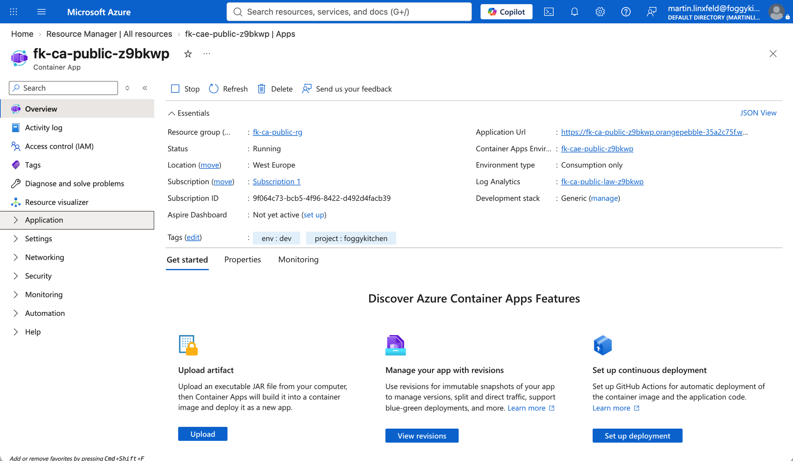
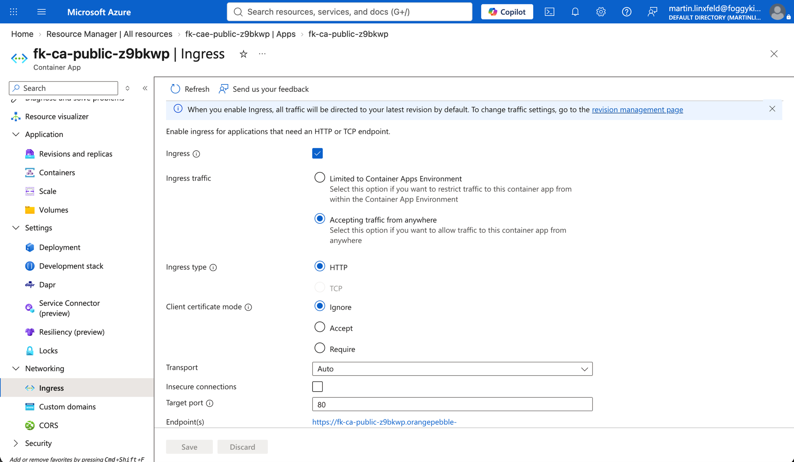
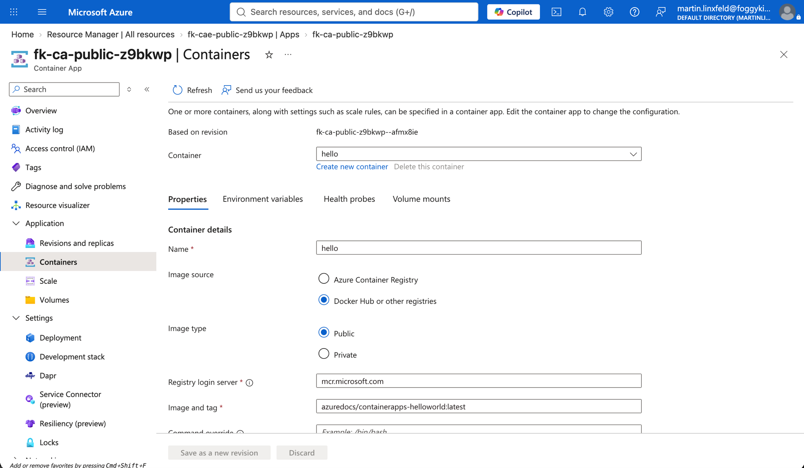
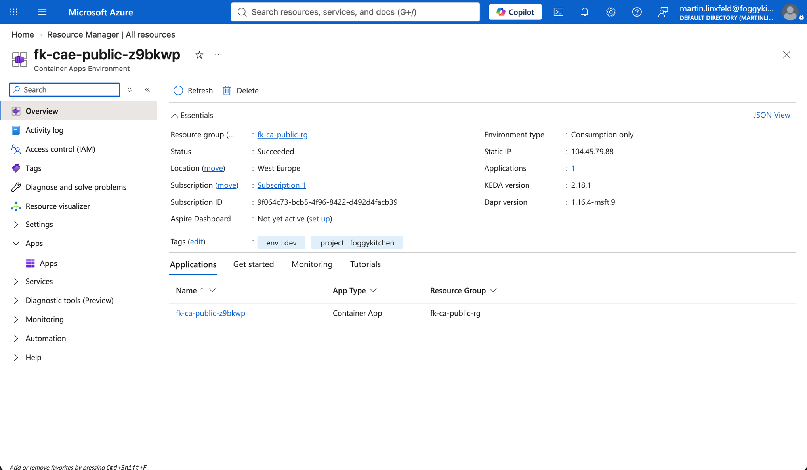
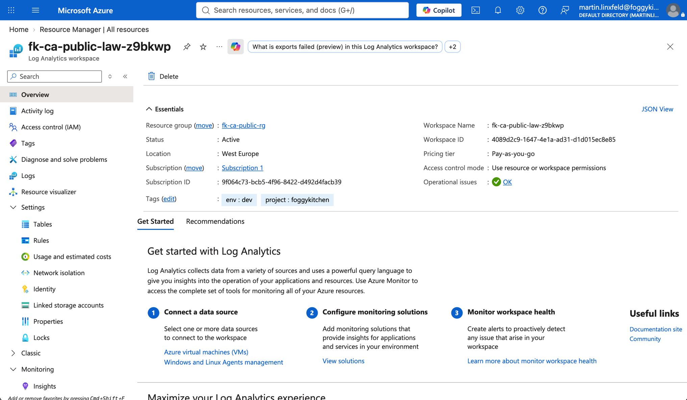
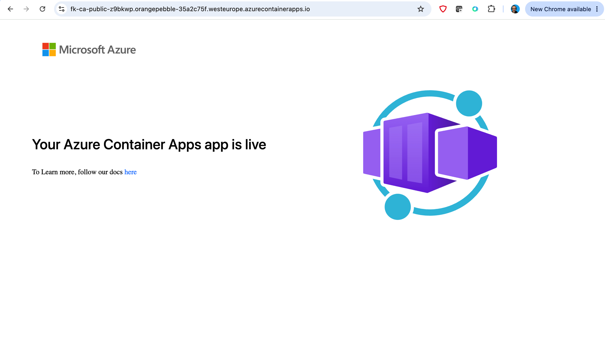

# Example 01: Public Container App

In this example, we deploy an **Azure Container App** through the
**terraform-az-fk-container-apps** module with a new **Container Apps Environment**
and a new **Log Analytics Workspace** created by **terraform-az-fk-log-analytics**.

This is the Azure Container Apps equivalent of the OCI public container instance
example: one public image, one managed runtime, and external HTTP ingress.

---

## Architecture Overview

This deployment creates:

- One Azure Resource Group
- One Log Analytics Workspace
- One Container Apps Environment
- One Container App running `mcr.microsoft.com/azuredocs/containerapps-helloworld`
- External ingress on port 80

It intentionally does not include VNet integration, private registry access, a
separate load balancer, or `terraform-az-fk-public-ip`. Azure Container Apps
external ingress exposes a managed public endpoint and FQDN; there is no separate
Azure Public IP resource to attach in this minimal pattern.

---

## Deployment Steps

From the `examples/01_public_container_app` directory:

```bash
cp terraform.tfvars.example terraform.tfvars
tofu init
tofu plan
tofu apply
```

After apply, verify the public endpoint:

```bash
curl https://$(tofu output -raw latest_revision_fqdn)
```

---

## Azure Portal View



*Figure 1. Container App overview showing the running app, public application URL, Container Apps Environment, and Log Analytics Workspace.*



*Figure 2. Ingress configuration accepting traffic from anywhere on target port 80.*



*Figure 3. Container configuration using the public `mcr.microsoft.com/azuredocs/containerapps-helloworld:latest` image.*



*Figure 4. Container Apps Environment overview showing Consumption-only mode, static environment IP, and the deployed application.*



*Figure 5. Log Analytics Workspace overview created by the dedicated FoggyKitchen Log Analytics module.*



*Figure 6. Public HTTP access to the Container App application URL.*

---

## Outputs

- `container_app_id` - Container App resource ID
- `container_app_name` - Container App name
- `environment_id` - Container Apps Environment resource ID
- `environment_default_domain` - environment default domain
- `environment_static_ip_address` - environment static IP address
- `latest_revision_fqdn` - latest revision FQDN
- `principal_id` - Container App managed identity principal ID

---

## Cleanup

```bash
tofu destroy
```

---

## License

Licensed under the **Universal Permissive License (UPL), Version 1.0**.

---

© 2026 [FoggyKitchen.com](https://foggykitchen.com) - Cloud. Code. Clarity.
