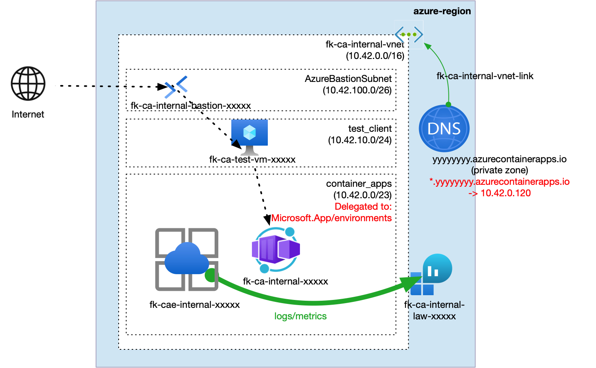
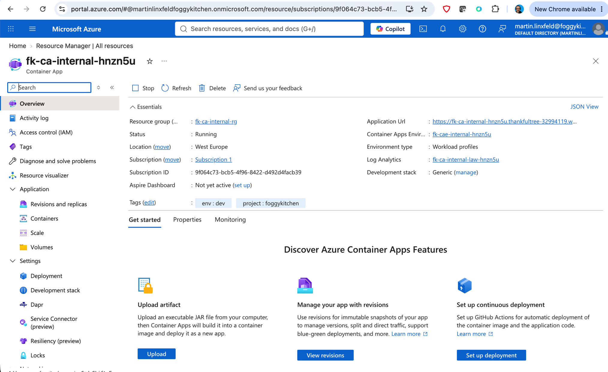
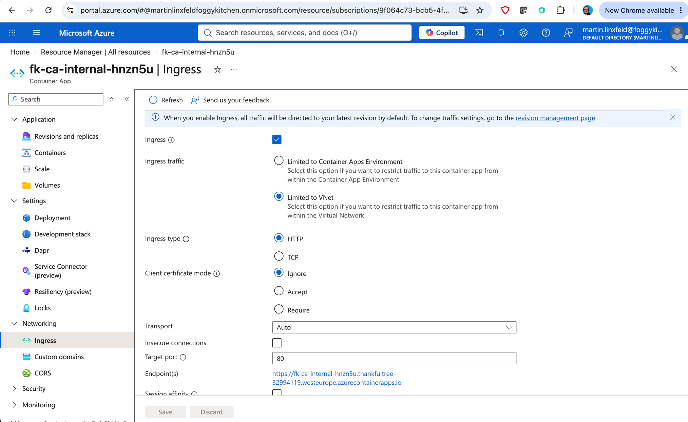
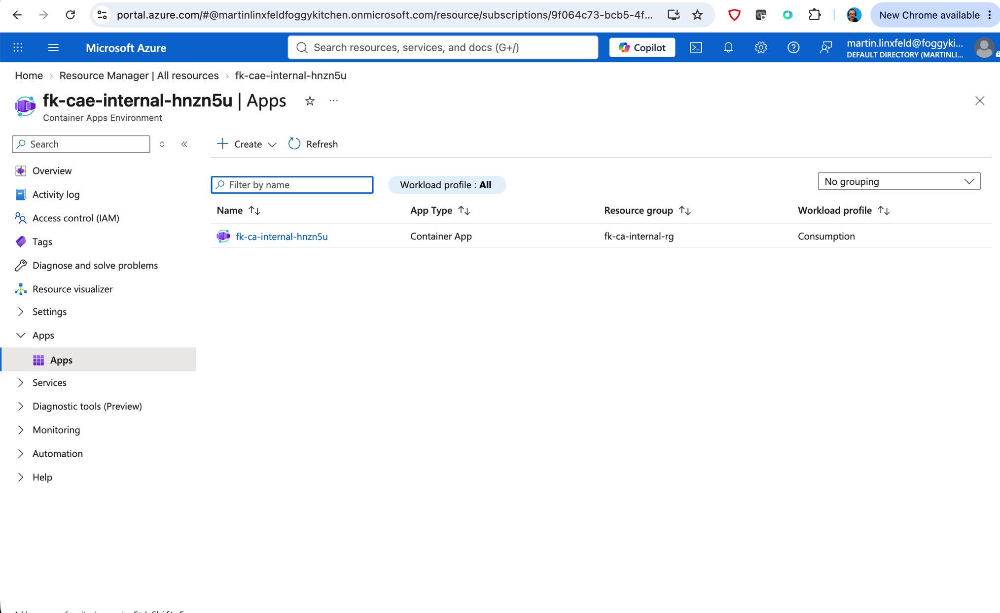
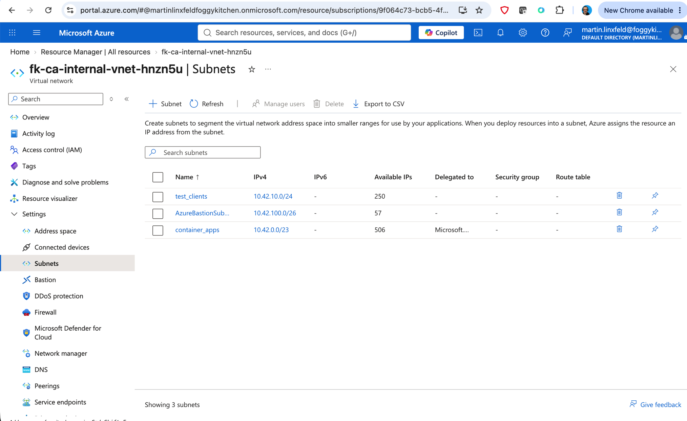
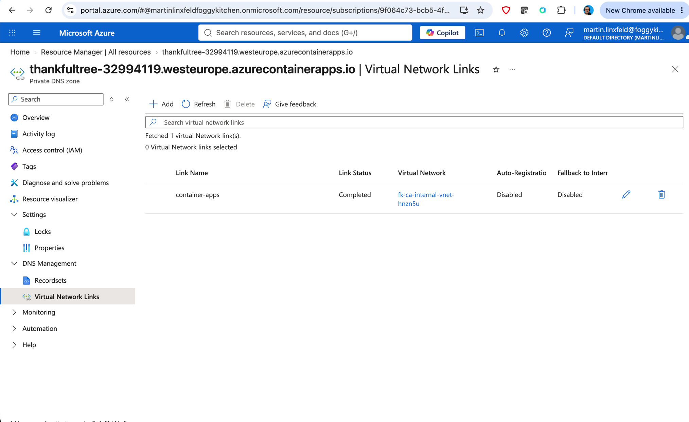
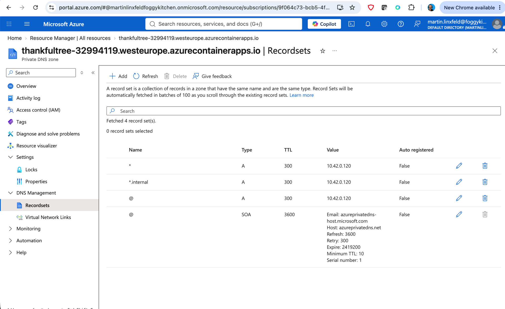
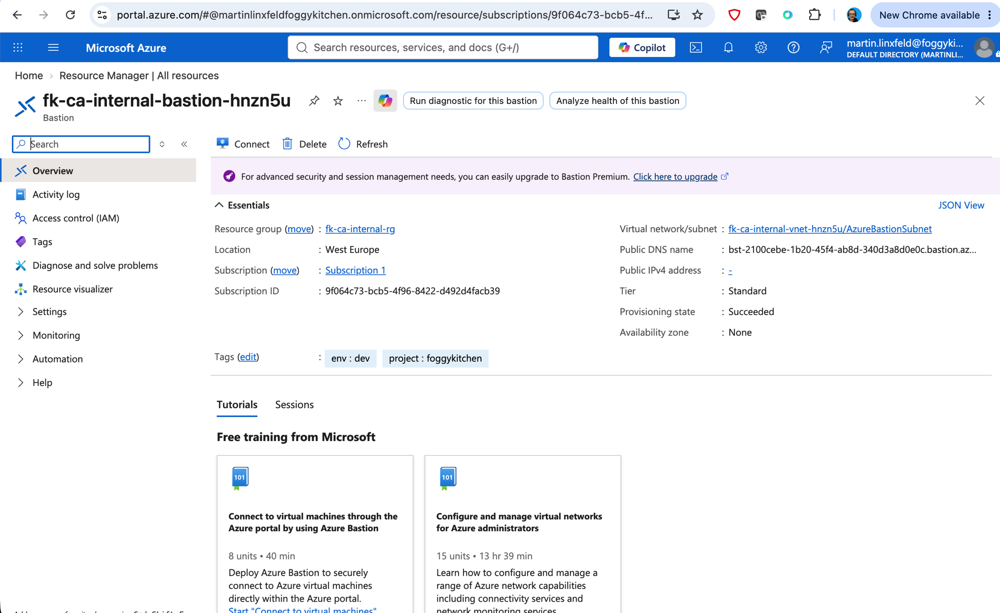
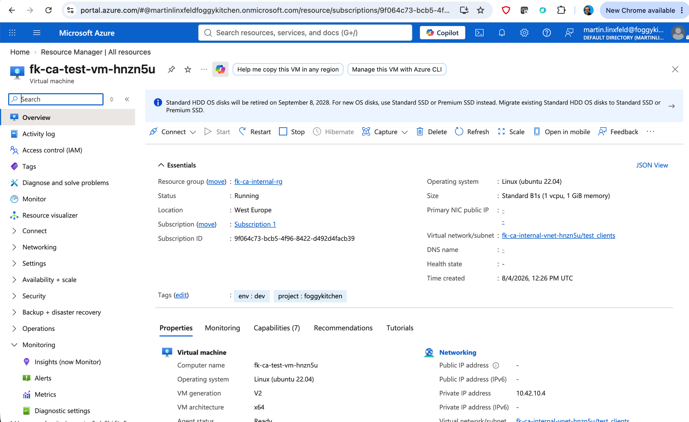

# Example 02: Internal VNet Integration

In this example, we deploy an **Azure Container App** in a new **Container Apps
Environment** integrated with a dedicated VNet subnet from **terraform-az-fk-vnet**.
We also deploy **Azure Bastion** through **terraform-az-fk-bastion** and a private
test VM through **terraform-az-fk-compute** so the internal endpoint can be tested
without exposing SSH or the app publicly.

This mirrors the OCI private container instance with load balancer pattern, but
the Azure structure is different: Container Apps ingress plus the environment
`internal_load_balancer_enabled` flag is the managed internal access path. No
separate **terraform-az-fk-loadbalancer** composition is needed here.

---

## Architecture Overview



*Figure 1. Internal Container Apps Environment with VNet integration, Private DNS, Azure Bastion, and a private test VM used to verify VNet-scoped ingress.*

This deployment creates:

- One Azure Resource Group
- One VNet with a delegated `/23` Container Apps infrastructure subnet
- One regular subnet reserved for test clients
- One `AzureBastionSubnet`
- One Log Analytics Workspace
- One Private DNS Zone matching the Container Apps Environment default domain through **terraform-az-fk-private-dns**
- One Azure Bastion host with its managed Public IP
- One private Linux test VM
- One Container Apps Environment with internal load balancing enabled
- One Container App running `mcr.microsoft.com/azuredocs/containerapps-helloworld`
- VNet-scoped ingress on port 80

The Container App ingress is enabled for traffic from outside the Container Apps
Environment, while the Environment itself uses an internal load balancer. The app
endpoint is reachable from the VNet path, not from the public internet.
The Bastion Public IP is for browser/native-client access to the private test VM;
it is not attached to the Container App.
Internal Container Apps ingress requires private DNS for clients in the VNet.
This example uses **terraform-az-fk-private-dns** to create a Private DNS Zone
that matches the environment default domain, link it to the VNet, and map `@`,
`*`, and `*.internal` records to the environment static IP.

---

## Deployment Steps

From the `examples/02_internal_vnet_integration` directory:

```bash
cp terraform.tfvars.example terraform.tfvars
tofu init
tofu plan
tofu apply
```

After apply, inspect the environment, app, Bastion host, and test VM:

```bash
az containerapp env show -g fk-ca-internal-rg -n <environment-name> --query "{name:name, internalLoadBalancerEnabled:properties.vnetConfiguration.internal, defaultDomain:properties.defaultDomain}" -o json
az containerapp show -g fk-ca-internal-rg -n <container-app-name> --query "{name:name, fqdn:properties.configuration.ingress.fqdn, external:properties.configuration.ingress.external}" -o json
az network bastion show -g fk-ca-internal-rg -n <bastion-name> --query "{name:name, provisioningState:provisioningState}" -o json
az vm show -g fk-ca-internal-rg -n <test-vm-name> -d --query "{name:name, privateIps:privateIps, publicIps:publicIps}" -o json
az network private-dns zone list -g fk-ca-internal-rg --query "[].name" -o table
```

To test HTTP access, connect to the private test VM through Azure Bastion. The
automatable path is Azure CLI native tunneling:

```bash
tofu output -raw test_vm_ssh_private_key_pem > /tmp/fk-ca-test-vm.pem
chmod 600 /tmp/fk-ca-test-vm.pem

az network bastion tunnel \
  --name "$(tofu output -raw bastion_name)" \
  --resource-group "$(tofu output -raw resource_group_name)" \
  --target-resource-id "$(tofu output -raw test_vm_id)" \
  --resource-port 22 \
  --port 2222
```

In another shell, run the private-network test through the tunnel:

```bash
APP_FQDN="$(tofu output -raw container_app_fqdn)"
ssh -i /tmp/fk-ca-test-vm.pem \
  -p 2222 \
  -o StrictHostKeyChecking=no \
  "$(tofu output -raw test_vm_admin_username)"@127.0.0.1 \
  "getent hosts $APP_FQDN && curl -k -i https://$APP_FQDN"
```

The DNS answer should resolve through the private Container Apps Environment path,
and the HTTP request should return the sample app response. Running the same
`curl` from a laptop without private network connectivity is expected to fail.

---

## Azure Portal View



*Figure 2. Container App overview showing the VNet-scoped application URL, Container Apps Environment, and running status.*



*Figure 3. Container App ingress configuration using the Environment internal load balancer path.*



*Figure 4. Container Apps Environment overview showing the internal environment, static IP address, and deployed application.*



*Figure 5. VNet subnets including the delegated Container Apps infrastructure subnet, test client subnet, and AzureBastionSubnet.*



*Figure 6. Private DNS Zone matching the Container Apps Environment default domain.*



*Figure 7. Private DNS records mapping Container Apps hostnames to the Environment static IP address.*



*Figure 8. Azure Bastion host used to reach the private test VM without exposing SSH publicly.*



*Figure 9. Private test VM deployed in the test client subnet with no public IP address.*

---

## Internal HTTP Test Output

The private-network test resolves the Container App FQDN to the Environment
static IP address and reaches the application through HTTPS from the test VM:

```text
DNS:
10.42.0.120     fk-ca-internal-hnzn5u.thankfultree-32994119.westeurope.azurecontainerapps.io

HTTPS:
HTTP/2 200
date: Tue, 04 Aug 2026 13:15:11 GMT
content-type: text/html; charset=utf-8

<title>Azure Container Apps - Welcome</title>
<h2 id=titleText>Your Azure Container Apps app is live</h2>
```

---

## Outputs

- `container_app_id` - Container App resource ID
- `container_app_name` - Container App name
- `container_app_fqdn` - Container App ingress FQDN
- `resource_group_name` - Resource Group name
- `environment_id` - Container Apps Environment resource ID
- `environment_default_domain` - environment default domain
- `environment_static_ip_address` - environment static IP address
- `latest_revision_fqdn` - latest revision FQDN
- `vnet_id` - VNet resource ID
- `container_apps_subnet_id` - delegated Container Apps subnet ID
- `test_clients_subnet_id` - subnet ID reserved for VNet-local test clients
- `private_dns_zone_names` - Private DNS Zone names linked to the VNet
- `container_apps_private_dns_record_names` - Private DNS record names for ACA ingress
- `bastion_name` - Azure Bastion host name
- `bastion_public_ip` - Azure Bastion Public IP address
- `test_vm_id` - private test VM resource ID
- `test_vm_private_ip` - private test VM IP address
- `test_vm_admin_username` - private test VM admin username
- `test_vm_ssh_private_key_pem` - private SSH key for the test VM, sensitive

---

## Cleanup

```bash
tofu destroy
```

---

## License

Licensed under the **Universal Permissive License (UPL), Version 1.0**.

---

© 2026 [FoggyKitchen.com](https://foggykitchen.com) - Cloud. Code. Clarity.
