# Example 03: ACR Image With Managed Identity

In this example, we deploy an **Azure Container Registry (ACR)** through
**terraform-az-fk-acr** and an **Azure Container App** through
**terraform-az-fk-container-apps**. The app pulls the image from ACR with a
user-assigned managed identity, not ACR admin credentials.

This example keeps the same private network and Bastion test path as
`02_internal_vnet_integration`. The difference is the workload image path: the
container image is imported into ACR and pulled by the Container App with managed
identity.

---

## Architecture Overview

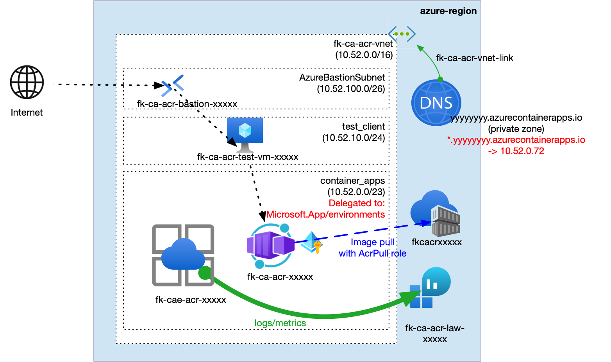

*Figure 1. Private Container Apps deployment with ACR image pull through user-assigned managed identity and VNet-local testing through Azure Bastion.*

This deployment creates:

- One Azure Resource Group
- One VNet with:
  - one delegated `/23` Container Apps infrastructure subnet
  - one regular test client subnet
  - one `AzureBastionSubnet`
- One Log Analytics Workspace
- One Private DNS Zone matching the Container Apps Environment default domain
- One Azure Container Registry with admin credentials disabled
- One public Microsoft sample image imported into ACR as `foggykitchen-hello-world`
- One Azure Bastion host with its managed Public IP
- One private Linux test VM
- One Container Apps Environment with internal load balancing enabled
- One user-assigned managed identity for ACR image pulls
- One Container App using that managed identity
- One `AcrPull` role assignment through **terraform-az-fk-rbac**

The Container App ingress is enabled for traffic from outside the Container Apps
Environment, while the Environment itself uses an internal load balancer. The app
endpoint is reachable from the VNet path, not from the public internet. This
example creates a Private DNS Zone that matches the environment default domain,
links it to the VNet, and maps `@`, `*`, and `*.internal` records to the
environment static IP.

The Container App registry block uses the user-assigned identity resource ID.
The `AcrPull` role assignment is created before the Container App, so the first
revision can pull from ACR during initial provisioning.

---

## Deployment Steps

From the `examples/03_acr_image_with_managed_identity` directory:

```bash
cp terraform.tfvars.example terraform.tfvars
tofu init
tofu plan
tofu apply
```

This example uses Azure CLI to import a public Microsoft Container Registry image
into ACR:

```bash
az acr import --name <acr-name> --source mcr.microsoft.com/azuredocs/containerapps-helloworld:latest --image foggykitchen-hello-world:latest --force
```

No ACR admin username or password is used.

After apply, verify RBAC, the app, Bastion, and the test VM:

```bash
az role assignment list --scope <acr-id> --query "[?roleDefinitionName=='AcrPull'].{role:roleDefinitionName, principalId:principalId}" -o table
az containerapp show -g fk-ca-acr-rg -n <container-app-name> --query "{name:name, image:properties.template.containers[0].image, identity:identity.type}" -o json
az network bastion show -g fk-ca-acr-rg -n <bastion-name> --query "{name:name, provisioningState:provisioningState}" -o json
az vm show -g fk-ca-acr-rg -n <test-vm-name> -d --query "{name:name, privateIps:privateIps, publicIps:publicIps}" -o json
az network private-dns zone list -g fk-ca-acr-rg --query "[].name" -o table
```

To test HTTP access, connect to the private test VM through Azure Bastion tunnel:

```bash
tofu output -raw test_vm_ssh_private_key_pem > /tmp/fk-ca-acr-test-vm.pem
chmod 600 /tmp/fk-ca-acr-test-vm.pem

az network bastion tunnel \
  --name "$(tofu output -raw bastion_name)" \
  --resource-group "$(tofu output -raw resource_group_name)" \
  --target-resource-id "$(tofu output -raw test_vm_id)" \
  --resource-port 22 \
  --port 2223
```

In another shell, run the private-network test through the tunnel:

```bash
APP_FQDN="$(tofu output -raw container_app_fqdn)"

ssh -i /tmp/fk-ca-acr-test-vm.pem \
  -p 2223 \
  -o StrictHostKeyChecking=no \
  "$(tofu output -raw test_vm_admin_username)"@127.0.0.1 \
  "getent hosts $APP_FQDN && curl -k -i https://$APP_FQDN"
```

The DNS answer should resolve through the private Container Apps Environment path,
and the HTTP request should return the sample app response. Running the same
`curl` from a laptop without private network connectivity is expected to fail.

---

## Azure Portal View

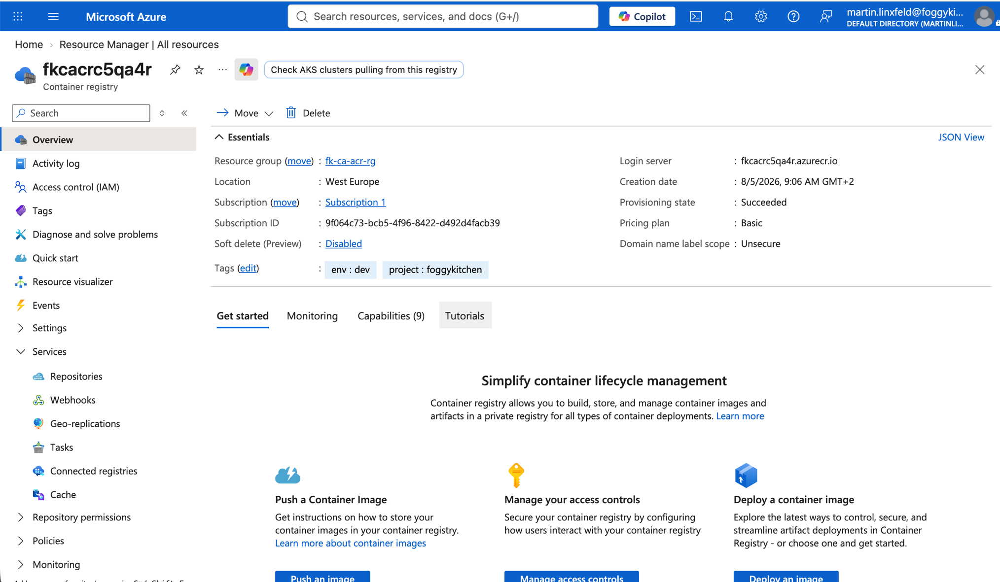

*Figure 2. Azure Container Registry overview showing the private registry used by the Container App.*

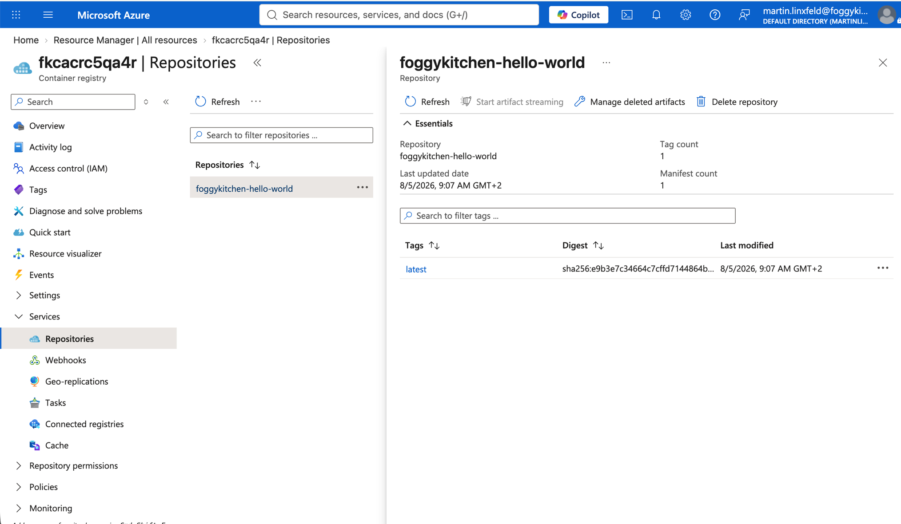

*Figure 3. ACR repository containing the imported `foggykitchen-hello-world:latest` image.*

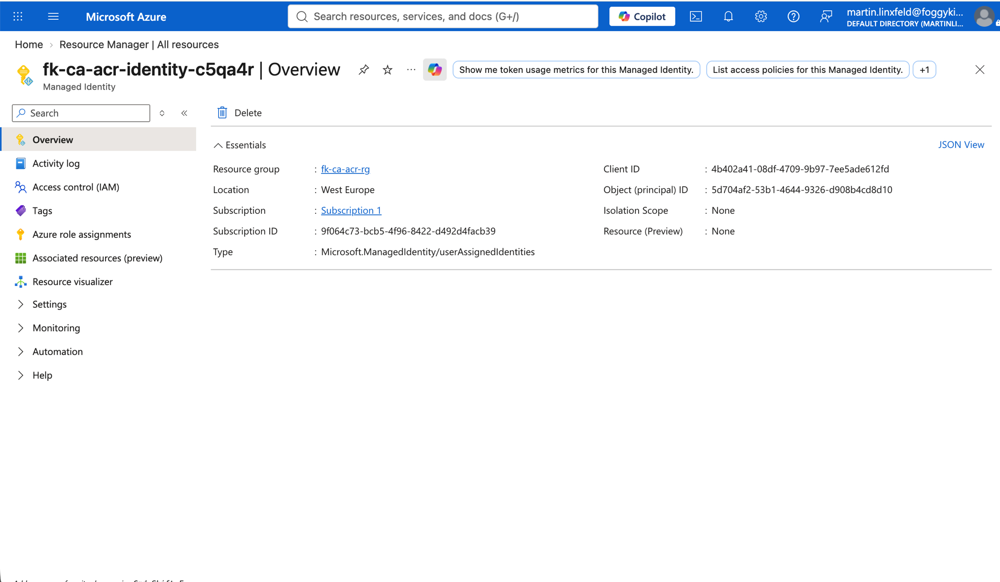

*Figure 4. User-assigned managed identity used by the Container App for ACR image pulls.*

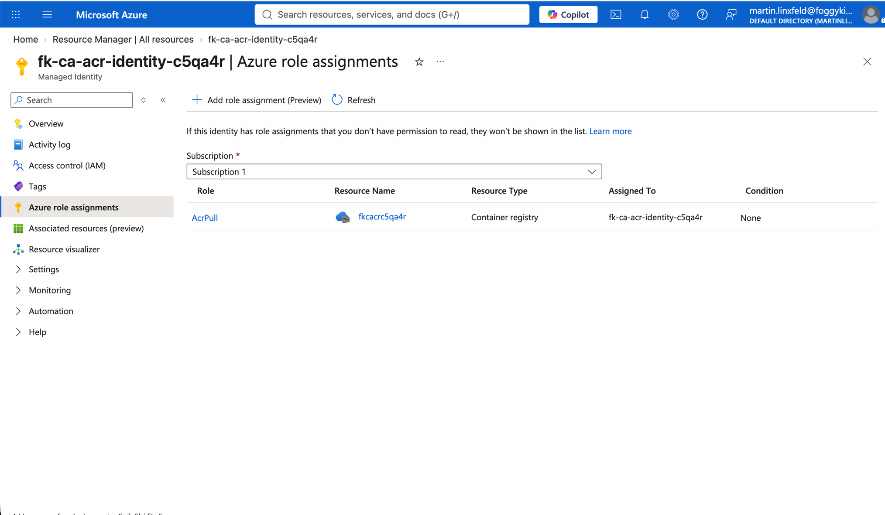

*Figure 5. `AcrPull` role assignment granting the managed identity access to the ACR scope.*

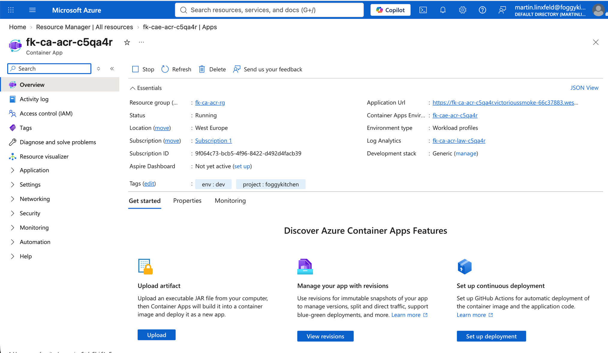

*Figure 6. Container App overview showing the running app, VNet-scoped application URL, Container Apps Environment, and Log Analytics Workspace.*

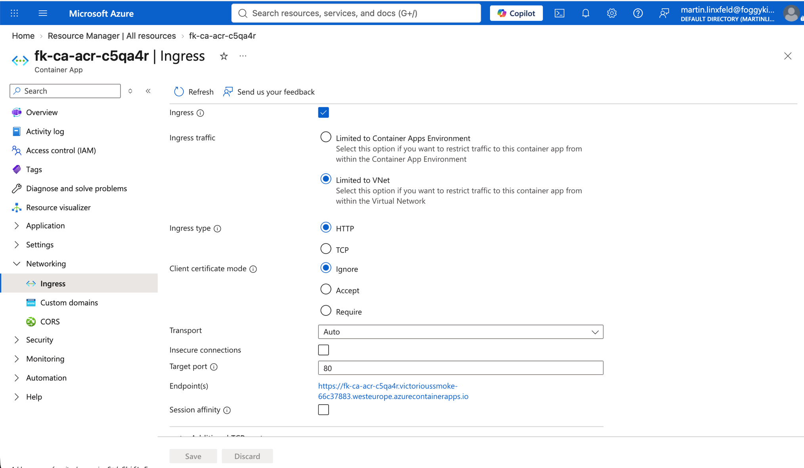

*Figure 7. Container App ingress limited to the VNet through the internal Container Apps Environment path.*

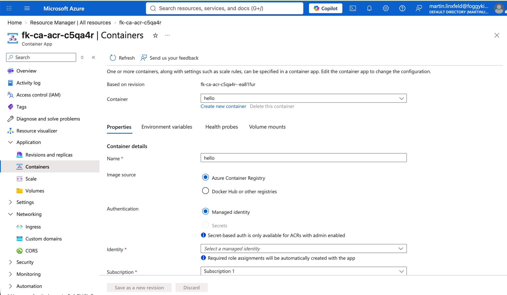

*Figure 8. Container configuration using Azure Container Registry as the image source and managed identity authentication.*

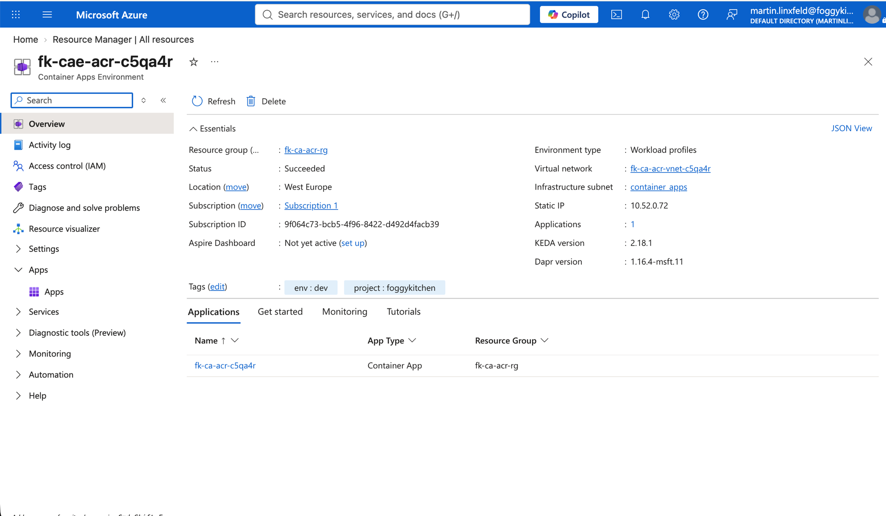

*Figure 9. Container Apps Environment overview showing VNet integration, infrastructure subnet, static IP address, and deployed application.*

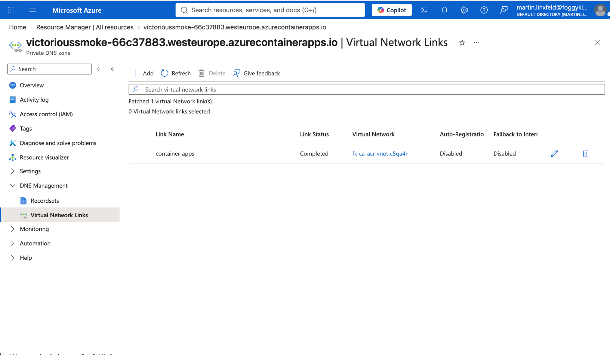

*Figure 10. Private DNS Zone linked to the VNet for Container Apps Environment name resolution.*

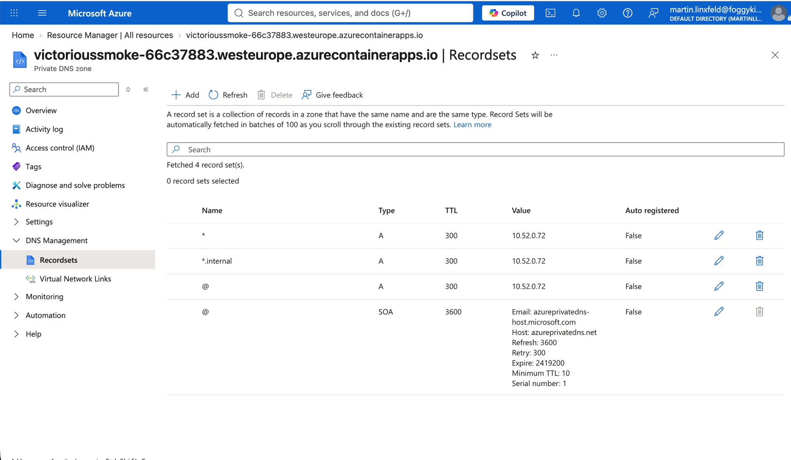

*Figure 11. Private DNS records mapping Container Apps hostnames to the Environment static IP address.*

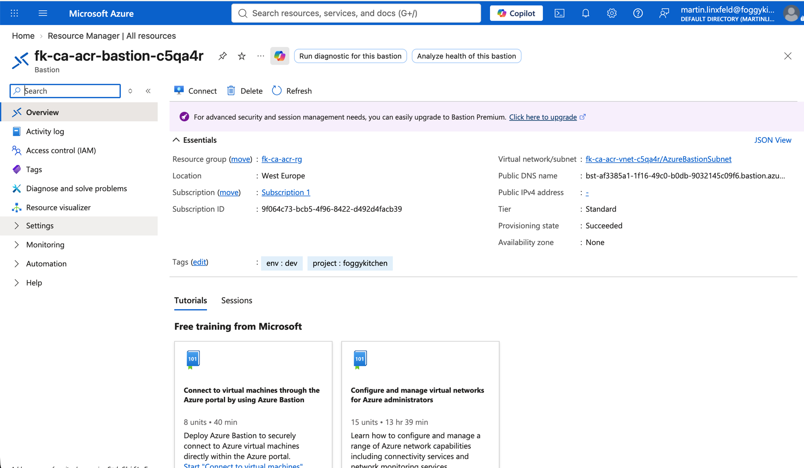

*Figure 12. Azure Bastion host used to reach the private test VM without exposing SSH publicly.*

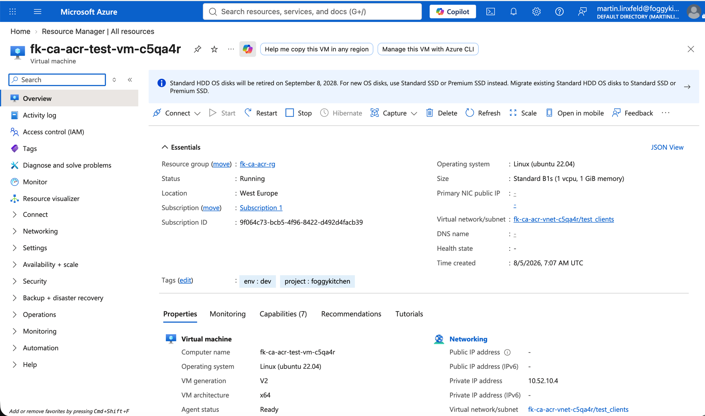

*Figure 13. Private test VM deployed in the test client subnet with no public IP address.*

---

## Internal HTTP Test Output

The private-network test resolves the Container App FQDN to the Environment
static IP address and reaches the ACR-backed application through HTTPS from the
test VM:

```text
DNS:
10.52.0.72      fk-ca-acr-c5qa4r.victorioussmoke-66c37883.westeurope.azurecontainerapps.io

HTTPS:
HTTP/2 200
date: Wed, 05 Aug 2026 08:18:05 GMT
content-type: text/html; charset=utf-8

<title>Azure Container Apps - Welcome</title>
```

---

## Outputs

- `container_app_id` - Container App resource ID
- `container_app_name` - Container App name
- `container_app_fqdn` - Container App ingress FQDN
- `resource_group_name` - Resource Group name
- `container_app_principal_id` - Container App managed identity principal ID
- `container_app_identity_id` - Container App user-assigned identity resource ID
- `environment_id` - Container Apps Environment resource ID
- `environment_default_domain` - environment default domain
- `environment_static_ip_address` - environment static IP address
- `latest_revision_fqdn` - latest revision FQDN
- `acr_id` - Azure Container Registry resource ID
- `acr_name` - Azure Container Registry name
- `acr_login_server` - ACR login server hostname
- `vnet_id` - VNet resource ID
- `container_apps_subnet_id` - delegated Container Apps subnet ID
- `test_clients_subnet_id` - subnet ID reserved for VNet-local test clients
- `private_dns_zone_names` - Private DNS Zone names linked to the VNet
- `container_apps_private_dns_record_names` - Private DNS record names for ACA ingress
- `bastion_name` - Azure Bastion host name
- `bastion_public_ip` - Azure Bastion Public IP address
- `test_vm_id` - private test VM resource ID
- `test_vm_private_ip` - private test VM IP address
- `test_vm_admin_username` - private test VM admin username
- `test_vm_ssh_private_key_pem` - private SSH key for the test VM, sensitive

---

## Cleanup

```bash
tofu destroy
```

---

## License

Licensed under the **Universal Permissive License (UPL), Version 1.0**.

---

© 2026 [FoggyKitchen.com](https://foggykitchen.com) - Cloud. Code. Clarity.
